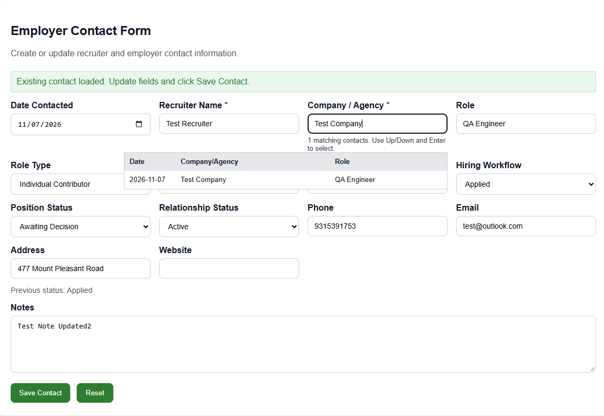

# TC-CONTACT-001 — Verify employer contact after migration

- **Requirement:** [REQ-MIG-001](../../migration.sdoc)
- **MySQL baseline result:** PASS (steps 1–2)
- **PostgreSQL staging result:** PASS
- **Record:** QA tracker `1` → PostgreSQL pursuit `3`
- **Actual result:** The edited note persisted after reloading the page
  and reopening the contact. The contact date, hiring stage, and position
  status matched the values shown before the edit.
- [Note saved to PostgreSQL](PostgreSQL_Contact.png)
- [Updated note visible after reopening](PostgreSQL_Contact_Reload.png) 

## Setup

Use a synthetic employer contact in a MySQL test environment. Capture the
migration input before making the test edit so PostgreSQL staging can start
with the same original values.

| Step | Action | Expected result |
| --- | --- | --- |
| 1 | Open the contact in MySQL. Record its original tracker ID, status, dates, notes, and any existing workflow history. Use a read-only query for the ID if the UI does not display it. | The original record and its values are captured as the baseline. |
| 2 | In MySQL, make a known change to the contact notes. Save, close, and reopen the contact. | The updated notes persist. The status and dates still match the baseline. |
| 3 | After migration, open the contact in PostgreSQL staging before editing it. Use the migration mapping or a read-only query to verify the original tracker ID. | The original ID traces to one migrated tracking record. Its pre-edit status, dates, notes, and existing workflow history match the captured baseline. |
| 4 | Repeat the same notes edit in PostgreSQL staging. Save, close, and reopen the contact. | The edited note persists and the status and dates still match the baseline.

## MySQL baseline evidence

- **Original MySQL tracker ID:** `1`
- **Step 2 actual result:** PASS. The updated note persisted after reopening
  and was confirmed in QA MySQL.
- **Observation:** The form displayed `QA Engineer`, while MySQL `role_title`
  was `NULL`. The source of the displayed role is pending verification.

  - **Field mapping verified for tracker `1`:** The displayed Role (`QA Engineer`)
  is stored in `role_level`, and the displayed Role Type (`Individual
  Contributor`) is stored in `role_category`. Both `role_title` and

  `role_type` are NULL on this row.

